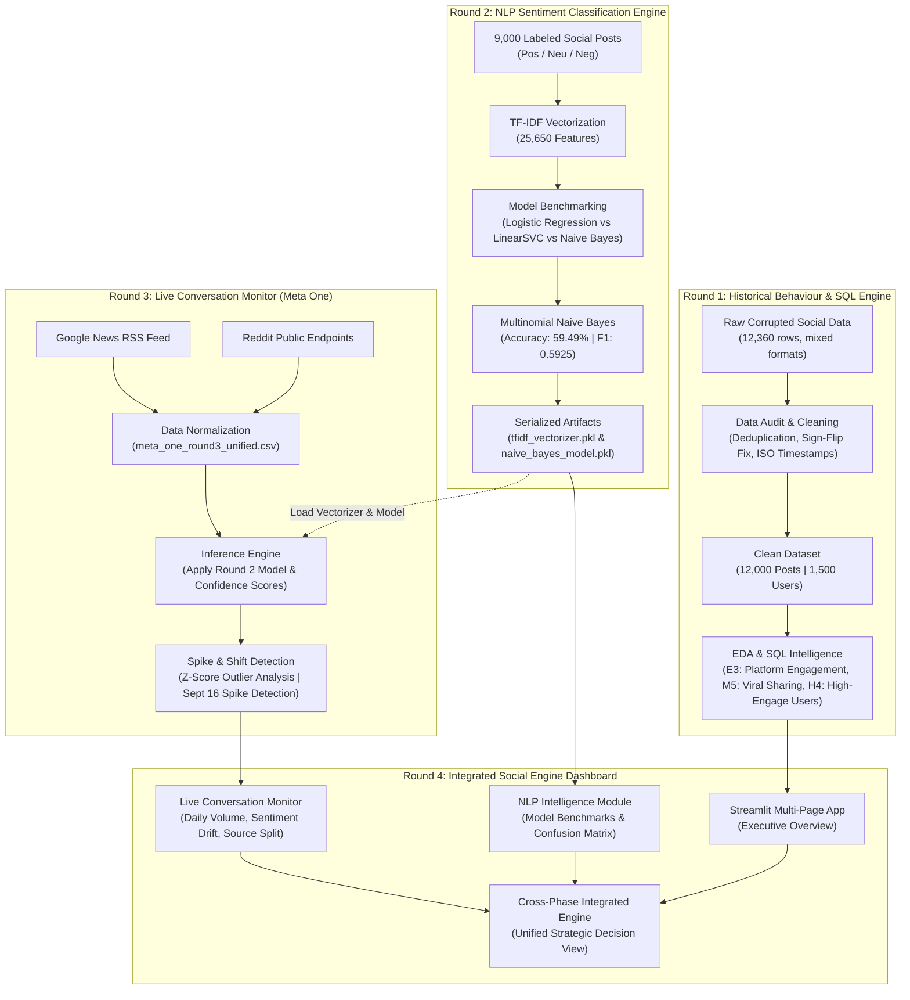

# DATA VORTEX — Social Engine 🌪️📊

[](https://www.python.org/)
[](https://streamlit.io/)
[](https://scikit-learn.org/)
[](https://plotly.com/)
[](https://pandas.pydata.org/)
[]()

> **An End-to-End Social Intelligence and Analytics Platform**  
> Unifying historical behavioural data auditing, machine learning sentiment classification, live multi-source conversation monitoring, and an interactive executive intelligence dashboard.

---

## 📑 Table of Contents

1. [Executive Summary](#-executive-summary)
2. [System Architecture](#-system-architecture)
3. [Repository Directory Structure](#-repository-directory-structure)
4. [Lifecycle & Round Breakdown](#-lifecycle--round-breakdown)
   - [Round 1: Rebuilding the Social Engine (Audit, Cleaning, EDA & SQL)](#round-1--rebuilding-the-social-engine)
   - [Round 2: NLP Sentiment Classification Engine](#round-2--nlp-sentiment-classification-engine)
   - [Round 3: Live Conversation Monitoring & Public Reaction Tracking](#round-3--live-conversation-monitoring--public-reaction-tracking)
   - [Round 4: Integrated Social Engine (Interactive Streamlit Portal)](#round-4--integrated-social-engine)
5. [Key Analytical Signals & Business Insights](#-key-analytical-signals--business-insights)
6. [Technology Stack](#-technology-stack)
7. [Installation & Quickstart Guide](#-installation--quickstart-guide)
8. [Reproducibility & Execution Flow](#-reproducibility--execution-flow)
9. [License & Acknowledgements](#-license--acknowledgements)

---

## 🔭 Executive Summary

**DATA VORTEX — Social Engine** is a comprehensive, multi-phase data science and intelligence platform engineered to transform raw, noisy, and corrupted social media streams into actionable, real-time strategic insights. 

Built in four sequential, modular phases ("Rounds"), the platform addresses the entire lifecycle of enterprise social data engineering:

1. **Data Integrity & Historical Behavioral Analysis:** Reconstructed and audited 12,360 corrupted posts across 5 major social networks down to 12,000 pristine records, uncovering viral sharing anomalies and high-impact micro-influencers.
2. **Natural Language Processing & Machine Learning:** Trained, evaluated, and serialized a 25,650-feature TF-IDF + Multinomial Naive Bayes sentiment engine on 9,000 labeled social records.
3. **Real-Time Public Reaction Tracking:** Deployed an automated scraping and normalization pipeline tracking live public discourse on the *Meta One* ecosystem across Google News and Reddit, using statistical Z-score algorithms to detect sentiment shifts and activity spikes.
4. **Full-Stack Integrated Intelligence Dashboard:** Synthesized all three upstream engines into a unified, interactive Streamlit application featuring executive KPI cards, Plotly visualizations, and drill-down analytics.

---

## 🏛️ System Architecture



---

## 📂 Repository Directory Structure

```text
DATA-VORTEX-SOCIAL-ENGINE/
│
├── DATA-VORTEX-ROUND 1/                     # Round 1: Data Audit, Cleaning & SQL Insights
│   ├── .gitignore                           # Round-level Git ignore rules
│   ├── data/
│   │   ├── raw/                             # Corrupted raw datasets (posts & users)
│   │   └── processed/                       # Cleaned posts (12,000 rows) & EDA artifacts
│   ├── notebooks/
│   │   ├── 01_Data_Audit.ipynb              # Quality audit, anomaly detection & recovery logic
│   │   └── 02_EDA_Insights.ipynb            # Visual exploratory data analysis & correlations
│   └── Round 1-phase-2/
│       ├── EDA_Report.md                    # Comprehensive Markdown EDA and findings report
│       ├── DATA VORTEX - ROUND 1 (PHASE 2) - Insight report.pdf
│       ├── DATA VORTEX - ROUND 1 (PHASE 2) - SQL query.pdf
│       └── DATA VORTEX - ROUND 1 (PHASE 2) - Explanation of logic.pdf
│
├── DATA-VORTEX-ROUND 2/                     # Round 2: NLP Sentiment Classification Engine
│   ├── data/
│   │   └── raw/
│   │       └── Labeled_Social_NLP_Text.csv  # 9,000 labeled multi-platform training records
│   ├── models/
│   │   ├── tfidf_vectorizer.pkl             # Trained TF-IDF vectorizer (25,650 n-gram features)
│   │   └── naive_bayes_sentiment_model.pkl  # Trained Multinomial Naive Bayes classifier
│   ├── notebooks/
│   │   └── 01_NLP_Data_Audit.ipynb          # Preprocessing, model training & benchmark evaluation
│   ├── reports/
│   │   ├── final_naive_bayes_metrics.csv    # Accuracy, Macro/Weighted Precision, Recall, F1
│   │   ├── naive_bayes_classification_report.csv # Class-level metrics (Negative, Neutral, Positive)
│   │   ├── naive_bayes_confusion_matrix.png # Confusion matrix heatmap visualization
│   │   └── final_sentiment_dataset.csv      # Processed sentiment predictions
│   ├── DATA VORTEX - Round 2 Technical Report.pdf
│   └── DATA VORTEX - Round 2 Evaluation Metrics Report.pdf
│
├── DATA-VORTEX-ROUND 3/                     # Round 3: Live Conversation Tracking (Meta One)
│   ├── data/
│   │   ├── raw/                             # Raw Google News RSS & Reddit public extractions
│   │   └── processed/
│   │       ├── meta_one_round3_unified.csv  # Standardized 160 multi-source live posts
│   │       ├── meta_one_round3_sentiment.csv# Live posts with model-inferred sentiment & confidence
│   │       └── meta_one_round3_shift_analysis.csv # Daily sentiment shares & volume shifts
│   ├── models/                              # Serialized Round 2 inference models
│   ├── scripts/
│   │   ├── 01_collect_meta_one_news.py      # Automated Google News RSS harvester
│   │   ├── 08_create_reddit_public_dataset.py # Reddit public topic data extractor
│   │   ├── 10_build_unified_dataset.py      # Multi-source data standardizer and deduplicator
│   │   ├── 11_apply_round2_model.py         # Batch inference using Round 2 TF-IDF + Naive Bayes
│   │   ├── 12_sentiment_timeline.py         # Daily sentiment distribution aggregator
│   │   ├── 13_detect_shifts_and_spikes.py   # Z-score spike detector & percentage point shifts
│   │   └── 14_inspect_trigger_dates.py      # Deep inspection of outlier event dates (Sept 16)
│   ├── notebooks/
│   │   └── 01_Round3_Analysis.ipynb         # Exploratory shift and anomaly notebook
│   ├── Round 3 Analysis Notebook.pdf
│   └── Round 3 Analytical Report.pdf
│
├── DATA-VORTEX-ROUND4/                      # Round 4: Integrated Social Engine (Streamlit Web App)
│   ├── app.py                               # Production Streamlit application (5 interactive tabs)
│   ├── requirements.txt                     # Dashboard dependencies
│   ├── data/
│   │   ├── integrated/                      # Cross-phase summaries and metrics
│   │   ├── round1/                          # Round 1 historical datasets
│   │   ├── round2/                          # Round 2 NLP datasets
│   │   └── round3/                          # Round 3 live conversation datasets
│   ├── models/                              # Packaged models for on-the-fly dashboard inference
│   └── reports/                             # Cross-phase evaluation charts and benchmark summaries
├── .gitignore                               # Root-level Git ignore rules
└── README.md                                # Master repository documentation (this file)
```

---

## 🔄 Lifecycle & Round Breakdown

### Round 1 — Rebuilding the Social Engine
*Data Quality Recovery, Exploratory Data Analysis & SQL Intelligence*

#### 1. Data Cleaning & Integrity Restoration
The raw dataset contained severe corruptions mimicking real-world social pipeline failures:
* **Negative Likes Sign-Flip**: Values such as `-340` were proved to be sign-flip corruptions through magnitude matching against valid engagement distributions; converted safely using `abs(likes)` with recovery flags.
* **Exact Duplicate Rows & Identical Post IDs**: 360 redundant rows safely eliminated without data loss, reducing 12,360 corrupted rows to exactly **12,000 unique posts**.
* **Mixed Timestamp Encodings**: Unified disparate formats (Unix epoch, Day-Month-Year dates, and ISO 8601 strings) into standardized UTC datetime objects.
* **HTML Entity Decoding**: Unescaped raw HTML entities (e.g., `&amp;`, `&quot;`) into standard text.
* **Preserving Missing Data**: Kept missing platform and text rows intact rather than inventing synthetic data.

#### 2. Exploratory Data Analysis (EDA) Highlights
* **Engagement Definition**: `likes + shares + comments`. Calculated on **10,186 complete records** to prevent missing likes from distorting engagement to zero.
* **Platform Comparison**:
  | Platform | Posts | Complete Records | Avg Engagement (EDA) | Avg Total Engagement (SQL) |
  | :--- | :---: | :---: | :---: | :---: |
  | **Instagram** | 1,989 | 1,693 | **4,040.02** | **3,669.38** |
  | **Reddit** | 2,031 | 1,742 | 4,003.94 | 3,647.47 |
  | **YouTube** | 2,073 | 1,747 | 4,031.84 | 3,638.03 |
  | **Facebook** | 2,074 | 1,755 | 4,015.99 | 3,631.00 |
  | **Twitter** | 2,049 | 1,725 | 3,951.91 | 3,563.75 |
* **Independent Engagement Dimensions**: Near-zero linear correlations between likes, shares, and comments ($r \approx 0.00$), showing that each interaction type represents a distinct user motivation.
* **Peak Timing Window**: **Wednesday at 7:00 PM** was identified as the highest-performing reliable posting window (avg engagement: **4,420.70**, sample size $N = 56$).

#### 3. Phase 2 SQL Analytical Queries
* **Query E3 (Platform Engagement)**: Ranked average total platform engagement across 12,000 posts.
* **Query M5 (Unusual Sharing Behaviour)**: Identified posts where shares exceeded the combined volume of likes and comments (`shares > likes + comments`). Uncovered **20 viral anomaly posts** peaking at 1,997 shares.
* **Query H4 (High-Engagement Micro-Influencer Discovery)**: Identified users in the top 10% engagement bracket with fewer than 5,000 followers. Discovered **16 high-efficiency creators**, with the top creator achieving **64,753 total engagement** across 16 posts with only 1,824 followers.

---

### Round 2 — NLP Sentiment Classification Engine
*Feature Engineering, Supervised Machine Learning & Model Evaluation*

#### 1. Dataset & Preprocessing
* **Corpus**: 9,000 social media text records across diverse topics (Community Discussion, Sports, Events, Tech).
* **Target Classes**: `Negative`, `Neutral`, `Positive`.
* **Vectorization**: Scikit-Learn `TfidfVectorizer` producing **25,650 n-gram features** with English stop-word removal and sublinear TF scaling.
* **Split**: 80% Training ($N = 7,183$), 20% Holdout Test ($N = 1,817$).

#### 2. Model Benchmarking & Performance
Three supervised classification architectures were evaluated:

| Model Architecture | Accuracy | Macro F1 | Weighted F1 | Selection Status |
| :--- | :---: | :---: | :---: | :---: |
| **Multinomial Naive Bayes (MultinomialNB)** | **59.49%** | **0.5916** | **0.5925** | 🏆 **Selected Best Model** |
| **Logistic Regression** | 58.83% | 0.5871 | 0.5878 | Baseline |
| **Linear Support Vector Classifier (LinearSVC)** | 57.57% | 0.5732 | 0.5740 | Candidate |

#### 3. Class-Level Metrics (MultinomialNB)
```text
              Precision    Recall  F1-Score   Support
Negative         0.6559    0.6232    0.6391       621
Neutral          0.5383    0.4739    0.5040       593
Positive         0.5858    0.6849    0.6315       603

Accuracy                             0.5949      1817
Macro Avg        0.5934    0.5940    0.5916      1817
Weighted Avg     0.5943    0.5949    0.5925      1817
```

* **Confusion Matrix Insights**:
  * Actual Negative correctly identified: **387**
  * Actual Neutral correctly identified: **281**
  * Actual Positive correctly identified: **413**
  * *Primary Error Vector*: Neutral posts misclassified as Positive (**179 records**), reflecting ambiguous or polite customer language in social discussion.
* **Serialization**: Exported as `models/tfidf_vectorizer.pkl` and `models/naive_bayes_sentiment_model.pkl`.

---

### Round 3 — Live Conversation Monitoring & Public Reaction Tracking
*Real-World Data Ingestion, Model Scoring & Statistical Event Detection*

#### 1. Multi-Source Ingestion Pipeline
Monitored public reception of **Meta One** (pricing structure, subscription fees, hardware features) using real-time harvesting scripts:
* **Google News RSS**: Ingested articles via structured queries (`"Meta One" pricing`, `"Meta One" subscription`, `"Meta One" complaints`), extracting titles, summaries, publication timestamps, and publisher links.
* **Reddit Public Ingestion**: Monitored relevant tech subreddits and discussion threads for organic public reactions and comment engagement.
* **Unified Dataset**: Merged into `meta_one_round3_unified.csv` (**160 curated records** spanning September 15 – September 20, 2026).

#### 2. Live Sentiment Inference
Applied Round 2's serialized TF-IDF vectorizer and Multinomial Naive Bayes model in batch inference mode (`11_apply_round2_model.py`):
* Outputted `predicted_sentiment` (`Positive`, `Neutral`, `Negative`) along with maximum probability `sentiment_confidence` scores (mean confidence: **~0.62**).

#### 3. Shift & Activity Spike Detection
Utilized daily volume Z-scores and percentage-point sentiment delta calculations:
* **Trigger Event Date Identified**: **September 16, 2026**
  * Daily Volume: **82 records** (over 50% of the entire sample window)
  * Activity Z-Score: **+1.65** (statistical outlier / volume spike)
  * Dominant Sentiment: **Positive** (60 positive posts, +6.50 percentage point lift)
* **Subsequent Sentiment Shift (September 18–20, 2026)**:
  * Positive sentiment dropped sharply (-22.22 percentage points) as pricing discussions and subscription critiques entered tech blogs and Reddit communities.

---

### Round 4 — Integrated Social Engine
*The Interactive Streamlit Executive Analytics Portal*

Round 4 brings all previous phases together into a unified, responsive Streamlit dashboard (`DATA-VORTEX-ROUND4/app.py`):

```text
┌────────────────────────────────────────────────────────────────────────────┐
│                       DATA VORTEX - Social Engine                          │
│                Round 4 | Integrated Social Intelligence Platform           │
├──────────────────┬─────────────────┬──────────────────┬────────────────────┤
│ 12,000 Posts     │ 9,000 NLP Rows  │ 160 Live Records │ 59.49% Model Acc   │
└──────────────────┴─────────────────┴──────────────────┴────────────────────┘
```

#### Dashboard Modules:
1. **Executive Overview**: High-level platform KPIs, end-to-end pipeline architecture flow, and cross-round signal summaries.
2. **Historical Analytics**: Interactive exploration of Round 1 SQL insights:
   * Bar chart of average platform engagement (Instagram leading at 3,669.38).
   * M5 Viral Sharing anomaly metric cards (20 qualifying posts, peak 1,997 shares).
   * H4 Micro-Influencer cards (16 high-efficiency creators, top 64,753 engagement).
3. **NLP Intelligence**:
   * Interactive benchmark comparison between Logistic Regression, LinearSVC, and Multinomial Naive Bayes.
   * Tabular precision, recall, and F1 class breakdown.
   * Interactive Plotly confusion matrix heatmap.
4. **Conversation Monitor**:
   * Real-time conversation volume line chart highlighting the Sept 16 spike.
   * Multi-line sentiment evolution over time (Negative vs Neutral vs Positive).
   * Source breakdown pie chart (News articles vs Reddit community discourse).
5. **Integrated Social Engine**:
   * Unified cross-phase view tying historical baseline engagement, live sentiment distributions, and strategic recommendations together for executive stakeholders.

---

## 💡 Key Analytical Signals & Business Insights

| Signal Type | Finding | Strategic Action |
| :--- | :--- | :--- |
| **Historical Baseline** | Instagram drives highest average engagement (**~3,669 - 4,040**), but platform differentials are narrow. | Focus on content resonance rather than platform selection alone. |
| **Engagement Independence** | Likes, shares, and comments have near-zero correlation ($r \approx 0.00$). | Measure virality by shares and community depth by comments; do not use likes as a proxy for total resonance. |
| **Micro-Influencer Leverage** | 16 users with $<5,000$ followers generated up to **64,753** total interactions. | Partner with high-engagement niche creators rather than expensive low-engagement macro-influencers. |
| **Optimal Posting Window** | Wednesday 7:00 PM consistently yields highest engagement (**4,420.70** avg). | Schedule major campaign announcements on Wednesday evenings for maximum initial reach. |
| **Product Launch Reaction** | Product announcement triggered a volume spike on **Sept 16 ($Z = 1.65$)** followed by a 22 pp negative sentiment shift. | Intervene with proactive pricing and value-proposition messaging within 48 hours of initial announcement. |

---

## 🛠️ Technology Stack

| Layer | Tools & Libraries | Purpose |
| :--- | :--- | :--- |
| **Core Runtime** | Python 3.10+ | Primary language across all rounds |
| **Data Processing** | Pandas, NumPy | Data cleaning, reshaping, aggregation, Z-scores |
| **Natural Language Processing** | Scikit-Learn, Regex | TF-IDF vectorization, tokenization, n-gram extraction |
| **Machine Learning** | MultinomialNB, LogisticRegression, LinearSVC, Joblib | Supervised classification and model serialization |
| **Live Ingestion** | Feedparser, Urllib, Requests | Google News RSS and Reddit public data harvesting |
| **Visualization & Reporting** | Plotly Express, Matplotlib, Seaborn | Interactive dashboard charts, heatmaps, distribution plots |
| **Web Application** | Streamlit | Executive multi-page analytics portal |
| **Database & Querying** | SQL / SQLite / In-Memory Pandas SQL | Relational aggregation queries (E3, M5, H4) |

---

## 🚀 Installation & Quickstart Guide

### Prerequisites
* Python 3.10, 3.11, or 3.12 installed on your machine
* `git` (optional, for cloning)

### 1. Clone the Repository
```bash
git clone https://github.com/your-username/DATA-VORTEX-SOCIAL-ENGINE.git
cd DATA-VORTEX-SOCIAL-ENGINE
```

### 2. Set Up a Virtual Environment
```bash
# Windows (PowerShell)
python -m venv .venv
.\.venv\Scripts\Activate.ps1

# Linux / macOS
python3 -m venv .venv
source .venv/bin/activate
```

### 3. Install Required Packages
```bash
pip install streamlit pandas numpy plotly scikit-learn joblib feedparser matplotlib seaborn
```

---

## 🏃 Reproducibility & Execution Flow

### Launching the Interactive Dashboard (Round 4)
To launch the primary executive dashboard directly:
```bash
cd "DATA-VORTEX-ROUND4"
streamlit run app.py
```
Open your browser at `http://localhost:8501`.

---

### Running Individual Pipeline Phases

#### To re-run Round 1 Data Cleaning & EDA:
```bash
cd "DATA-VORTEX-ROUND 1/notebooks"
jupyter notebook 01_Data_Audit.ipynb
jupyter notebook 02_EDA_Insights.ipynb
```

#### To re-run Round 2 NLP Model Training & Evaluation:
```bash
cd "DATA-VORTEX-ROUND 2/notebooks"
jupyter notebook 01_NLP_Data_Audit.ipynb
```

#### To re-run Round 3 Live Harvester & Inference Engine:
```bash
cd "DATA-VORTEX-ROUND 3"

# 1. Harvest latest Google News & Reddit feeds
python scripts/01_collect_meta_one_news.py
python scripts/08_create_reddit_public_dataset.py

# 2. Unify data streams
python scripts/10_build_unified_dataset.py

# 3. Apply Round 2 sentiment model
python scripts/11_apply_round2_model.py

# 4. Run shift, spike, and trigger detection
python scripts/13_detect_shifts_and_spikes.py
python scripts/14_inspect_trigger_dates.py
```

---

## 📜 Project Documentation Deliverables

Detailed technical reports and query explanations for each round are located in the respective subdirectories:
* **Round 1 Phase 2**:
  * [EDA_Report.md](file:///c:/Users/Jivan/OneDrive/Desktop/projectS/DATA-VORTEX-SOCIAL-ENGINE/DATA-VORTEX-ROUND%201/Round%201-phase-2/EDA_Report.md)
  * `DATA-VORTEX-ROUND 1/Round 1-phase-2/DATA VORTEX - ROUND 1 (PHASE 2) - Insight report.pdf`
  * `DATA-VORTEX-ROUND 1/Round 1-phase-2/DATA VORTEX - ROUND 1 (PHASE 2) - SQL query.pdf`
* **Round 2 NLP**:
  * `DATA-VORTEX-ROUND 2/DATA VORTEX - Round 2 Technical Report.pdf`
  * `DATA-VORTEX-ROUND 2/DATA VORTEX - Round 2 Evaluation Metrics Report.pdf`
* **Round 3 Live Conversation**:
  * `DATA-VORTEX-ROUND 3/Round 3 Analytical Report.pdf`
  * `DATA-VORTEX-ROUND 3/Round 3 Analysis Notebook.pdf`
* **Round 4 Web Application**:
  * [app.py](file:///c:/Users/Jivan/OneDrive/Desktop/projectS/DATA-VORTEX-SOCIAL-ENGINE/DATA-VORTEX-ROUND4/app.py)

---

## ⚖️ License & Acknowledgements

Developed as part of the **DATA VORTEX** data science and social engine challenge.  
Data generated, audited, and curated for multi-platform social analytics research.
